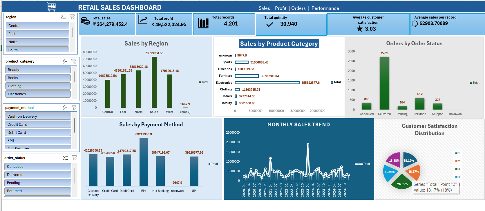

# Retail Sales Dynamic Dashboard (Task 3)

## Project Overview
This task involved building a fully interactive and dynamic Retail Sales Dashboard using Microsoft Excel based on the insights and charts structured in Task 2. The dashboard provides an intuitive, high-level business summary to enable data-driven decision-making.

## Dashboard Features & Layout

### 1. Overall KPIs (Key Performance Indicators)
The top section features prominent KPI cards displaying macro-level business performance:
- **Total Sales:** ₹264,279,452.40
- **Total Profit:** ₹49,522,324.95
- **Total Records:** 4,201
- **Total Quantity Sold:** 30,940
- **Average Customer Satisfaction:** 3.03 / 5.00
- **Average Sales Per Record:** ₹62,908.70

## Dashboard Preview

### 2. Interactive Slicers (Dynamic Controls)
To enable deep-dive analysis, four global slicers have been integrated on the left side of the dashboard. Clicking any item automatically updates all visuals simultaneously:
- **Region Slicer** (Central, East, North, South, West)
- **Product Category Slicer** (Beauty, Books, Clothing, Electronics, Sports, etc.)
- **Payment Method Slicer** (Cash on Delivery, Credit Card, Debit Card, EMI, UPI, etc.)
- **Order Status Slicer** (Cancelled, Delivered, Pending, Returned, Shipped)

### 3. Comprehensive Visualizations
- **Sales by Region:** A Clustered Column Chart identifying top-performing territories.
- **Sales by Product Category:** A Horizontal Bar Chart highlighting product revenue contributions.
- **Orders by Order Status:** A Column Chart tracking operational fulfillment and supply chain performance.
- **Sales by Payment Method:** A Column Chart displaying transactional distribution.
- **Monthly Sales Trend:** A Time-Series Line Chart revealing revenue volatility and peaks over time.
- **Customer Satisfaction Distribution:** A Percentage Pie Chart mapping rating buckets from 1 to 5.

---

## 🛠️ Tools & Advanced Features Used
- **Microsoft Excel Layout Design:** Grid alignment, consistent typography, and a modern corporate color theme.
- **Pivot Tables & Pivot Charts:** Backend infrastructure driving the calculations.
- **Slicer Connections:** Linked multiple Pivot Tables to a single set of slicers for seamless interactivity.
- **Custom Data Labels:** On-chart callouts for immediate readability.
